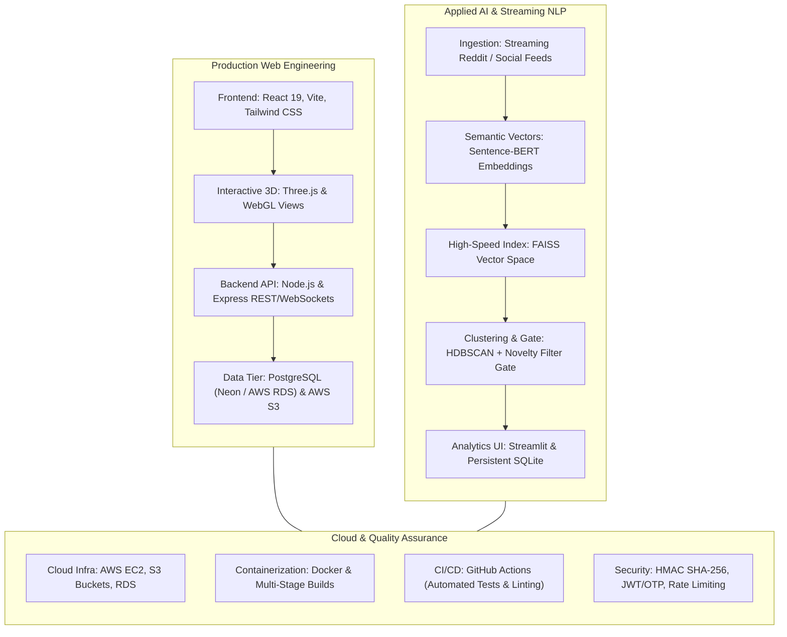
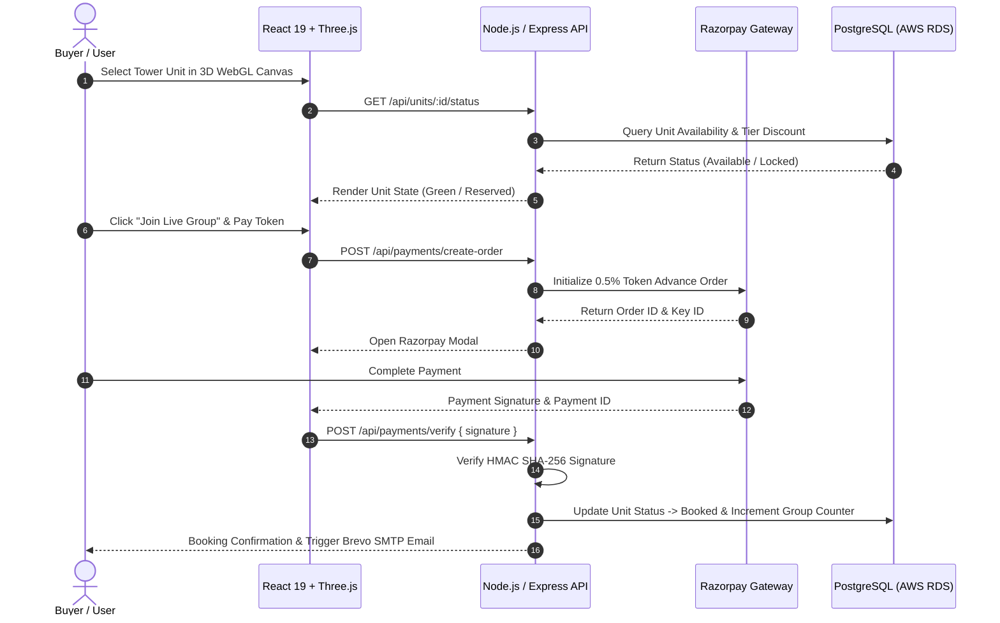
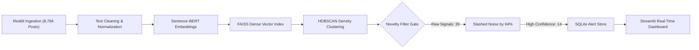
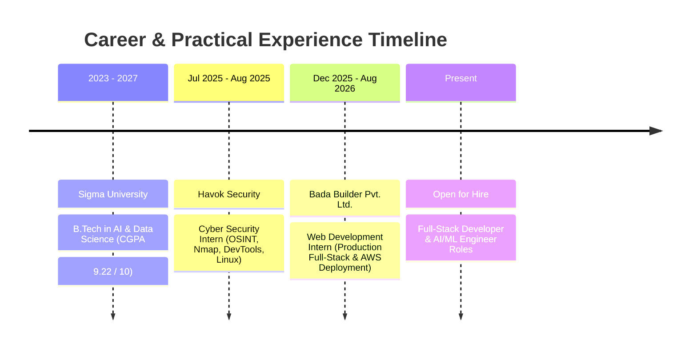
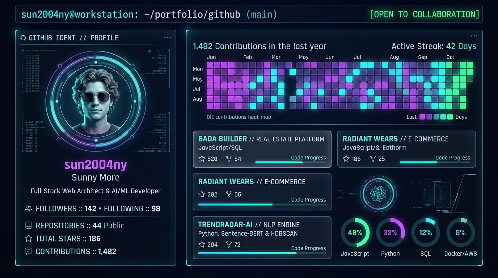

<picture>
  <source media="(prefers-color-scheme: dark)" srcset="https://raw.githubusercontent.com/sun2004ny/sun2004ny/main/dark.svg?v=20261120_hud" />
  <source media="(prefers-color-scheme: light)" srcset="https://raw.githubusercontent.com/sun2004ny/sun2004ny/main/light.svg?v=20261120_hud" />
  
</picture>

  

  

  

| 🌐 Production Full-Stack | 🧠 Streaming NLP & Vector Search | ☁️ Scalable Cloud & DevOps |
| :---: | :---: | :---: |
| React 19, Vite, Node.js, Express, PostgreSQL, Socket.io, 3D WebGL | Sentence-BERT, HDBSCAN clustering, FAISS vector search, Streamlit | AWS (EC2, S3, RDS), Docker, GitHub Actions CI/CD pipelines |

| 🏢 Multi-Role Architectures | 💳 Fintech & Payment Systems | 🛡️ Security & API Hardening |
| :---: | :---: | :---: |
| 5 enterprise RBAC portals (Admin, Dev, Broker, Employee, User) | Razorpay payment orders, subscription tiers, advance token booking | HMAC SHA-256 signatures, JWT/OTP auth, rate limiting, SQL protection |

 

---

## 📑 Table of Contents

<b>Click to expand / collapse navigation</b>

1. [Executive Summary & Bio](#-executive-summary--bio)
2. [Engineering Architecture & Focus Areas](#-engineering-architecture--focus-areas)
3. [Flagship Production Projects](#-flagship-production-projects)
   - [1. Bada Builder — Full-Scale Real Estate Ecosystem](#1-bada-builder--full-scale-real-estate-ecosystem)
   - [2. TrendRadar-AI — Emerging Event Detection NLP Engine](#2-trendradar-ai--emerging-event-detection-nlp-engine)
   - [3. RadiantWears — Full-Stack Clothing E-Commerce](#3-radiantwears--full-stack-clothing-e-commerce)
   - [4. Live Life Rehab — Healthcare & Wellness Platform](#4-live-life-rehab--healthcare--wellness-platform)
4. [Comprehensive Technical Skills Matrix](#-comprehensive-technical-skills-matrix)
5. [Production Experience & Career Timeline](#-production-experience--career-timeline)
6. [Education & Certifications](#-education--certifications)
7. [GitHub Analytics & Metrics](#-github-analytics--metrics)
8. [Contact & Collaboration](#-contact--collaboration)

---

## 🌐 Executive Summary & Bio

I am a final-year **B.Tech student in Artificial Intelligence and Data Science at Sigma University** (graduating class of 2027, maintaining a **9.22 / 10 CGPA**). My focus spans high-throughput full-stack web applications and production-grade NLP engineering.

During my **9-month internship at Bada Builder Pvt. Ltd.** (Dec 2025 – Aug 2026), I architected and shipped end-to-end features for a live commercial real estate platform on **AWS (EC2, S3, RDS)** — delivering 5 role-based dashboards, Three.js 3D spatial unit view, live group buying with tiered volume discounts, Razorpay checkout, real-time WebSocket chat, and automated transactional emails.

On the AI/ML frontier, I engineer streaming natural language processing systems like **TrendRadar-AI**, utilizing Sentence-BERT semantic embeddings, HDBSCAN density clustering, and FAISS vector indexing to catch emerging trends in Reddit/social streams before they peak, hardened with **58 automated pytest test suites and GitHub Actions CI**.

> [!NOTE]
> **Open to Opportunities:** Actively seeking **Full-Stack Software Engineer** and **AI/ML Engineer** roles (internships and full-time positions).

---

## 🏛️ Engineering Architecture & Focus Areas

---

## 🌟 Flagship Production Projects

### 1. Bada Builder — Full-Scale Real Estate Ecosystem

A production-grade multi-tenant real estate platform connecting individual buyers, developers, brokers, employees, and institutional investors.

* **5 Role-Based Dashboards:** Custom portal interfaces for Super Admin, Developers, Certified Brokers, Field Employees, and End-Users with strict RBAC guards.
* **3D Spatial Unit Selection:** Interactive Three.js/WebGL building visualizer with color-coded unit statuses (Available, Booked, Hold, Commercial).
* **Live Group Buying:** Dynamic pricing algorithm that unlocks progressive developer discounts as buyer group thresholds are met.
* **Fintech & Security:** Razorpay order creation with server-side HMAC SHA-256 signature verification, JWT + OTP email verification, and multi-tier rate limiting.
* **Tech Stack:** `React 19`, `Vite`, `Node.js / Express`, `PostgreSQL`, `Socket.io`, `AWS (EC2, S3, RDS)`, `Razorpay`, `Tailwind CSS`, `Three.js`, `KaTeX`.

---

### 2. TrendRadar-AI — Emerging Event Detection NLP Engine

A streaming NLP intelligence pipeline that detects emerging conversational events across social media platforms before they reach mainstream virality.

* **Evaluated on Real-World Data:** Benchmarked on **8,784 Reddit posts**, extracting dense semantic representations using `sentence-transformers`.
* **Novelty Gate Filtering:** Engineered a mathematical novelty score threshold that filtered noise down from **39 noisy alerts to 14 actionable events** (64% noise reduction).
* **Vector Optimization:** Accelerated high-dimensional vector search and clustering using a **FAISS vector index** coupled with **HDBSCAN**.
* **Engineering Rigor:** Built with production standards featuring **58 pytest unit tests**, automated linting, containerized with **Docker**, and continuous verification via **GitHub Actions**.
* **Tech Stack:** `Python`, `Sentence-BERT`, `HDBSCAN`, `FAISS`, `scikit-learn`, `pandas`, `NumPy`, `SQLite`, `Streamlit`, `Docker`, `GitHub Actions`.

---

### 3. RadiantWears — Full-Stack Clothing E-Commerce

A modern e-commerce storefront with real-time inventory management and an integrated administrative operating panel.

* **Customer Shopping Experience:** Real-time catalog filtering, dynamic faceted search, persistent cart state synchronization, customer authentication, and order lifecycle tracking.
* **Administrative Command Center:** Custom admin panel providing real-time product inventory mutation, order dispatch management, and revenue performance summaries.
* **Tech Stack:** `React.js`, `Vite`, `Node.js`, `Express.js`, `PostgreSQL (Neon DB)`, `Tailwind CSS`, `RESTful APIs`.

---

### 4. Live Life Rehab — Healthcare & Wellness Platform

A comprehensive 49-page responsive website engineered for an Indian de-addiction and rehabilitation wellness center.

* **Extensive Content Architecture:** 49 specialized pages detailing rehabilitation modalities, multi-city localized treatment facilities, medical advisory blogs, and immediate appointment booking flows.
* **Performance & Accessibility:** Semantic HTML5 structure, modular CSS3 styling, and client-side form validation for confidential patient inquiries.
* **Tech Stack:** `HTML5`, `CSS3`, `JavaScript (ES6+)`, `Responsive Web Architecture`.

---

## 🛠️ Comprehensive Technical Skills Matrix

| Domain | Core Technologies & Frameworks | Practical Application & Production Exposure |
|---|---|---|
| **Frontend Engineering** | `React.js (18/19)`, `Vite`, `Tailwind CSS`, `Three.js`, `React Three Fiber`, `Framer Motion`, `React Router` | Enterprise dashboards, 3D WebGL unit exploration, responsive layouts, client-side state caching. |
| **Backend & APIs** | `Node.js`, `Express.js`, `RESTful APIs`, `Socket.io (WebSockets)`, `JWT`, `Bcrypt`, `Nodemailer / Brevo SMTP` | 5 role-based auth portals, real-time messaging, transactional email queues, rate-limited public APIs. |
| **AI, ML & NLP** | `Sentence-BERT`, `HDBSCAN`, `FAISS`, `scikit-learn`, `pandas`, `NumPy`, `Streamlit`, `Python` | Semantic topic discovery, vector similarity search, novelty filtering, predictive machine learning pipelines. |
| **Databases & Storage** | `PostgreSQL`, `Neon DB`, `SQLite`, `AWS RDS`, `AWS S3`, `MongoDB`, `Firebase` | Relational schema design, connection pooling (`pg.Pool`), parameterized queries, cloud asset storage. |
| **DevOps & Cloud** | `AWS (EC2, S3, RDS)`, `Docker`, `GitHub Actions (CI/CD)`, `Linux / Bash`, `Vercel`, `Render` | Cloud hosting, multi-environment deployments, automated pytest workflows, Docker containerization. |
| **Security & QA** | `HMAC SHA-256`, `CORS`, `Helmet`, `Express Validator`, `pytest`, `Postman`, `Nmap / OSINT` | Payment signature verification, parameterized SQL injection defense, RBAC token verification, automated testing. |

---

## 💼 Production Experience & Career Timeline

### 🏢 Web Development Intern — Bada Builder Pvt. Ltd.
*Vadodara, Gujarat, India · Dec 2025 – Aug 2026 (9 months)*
* Developed core full-stack features for a commercial real estate platform connecting buyers, developers, brokers, and investors.
* Built **5 distinct role-based dashboards** (Admin, Developer, Broker, Employee, User) handling property submissions, KYC verifications, site visits, and lead attribution.
* Implemented the **Live Grouping** feature with interactive **Three.js 3D spatial models**, enabling buyers to inspect and book specific tower units.
* Built REST APIs with Node.js/Express, integrated **Razorpay** checkout, secured endpoints with JWT/OTP auth and express-rate-limit, managed **PostgreSQL on Neon DB/RDS**, and deployed on **AWS (EC2, S3, RDS)**.

### 🛡️ Cyber Security Intern — Havok Security
*Remote · Jul 2025 – Aug 2025 (2 months)*
* Performed OSINT reconnaissance (Google Dorking) and executed Nmap network scans to map active network topology, open ports, and services.
* Inspected HTTP network traffic, response payloads, and client-side runtime behavior using browser developer tools.
* Operated in Linux environments, collaborated using Git/GitHub, fixed website bugs, and assisted in site data backups.

---

## 🎓 Education & Certifications

### 🎓 Formal Education
* **Bachelor of Technology (B.Tech) in Artificial Intelligence & Data Science**  
  **Sigma University**, Vadodara, Gujarat, India  
  *Timeline:* 2023 – 2027 (Expected) · **Current CGPA: 9.22 / 10**

### 📜 Verified Certifications & Credentials
* **Python, Data Analysis & AI** — *Code Unnati (SAP & Edunet Foundation)*  
  Hands-on training in Python programming, exploratory data analysis, NumPy, pandas, and machine learning models.
* **Cross-Platform Development Using Flutter** — *BrainyBeam Info-Tech*  
  Mobile application architecture, state management, and cross-platform UI engineering.

---

## 📊 GitHub Telemetry & Pipeline Dashboard

  

 

---

## 📬 Contact & Collaboration

I am always interested in discussing full-stack engineering challenges, scalable system architectures, and production NLP/AI opportunities.

 

Designed & Engineered by <strong>Sunny More</strong> · Vadodara, India

