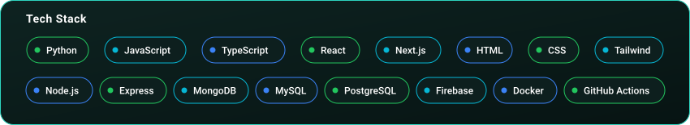

<picture>
  <source media="(prefers-color-scheme: dark)" srcset="https://raw.githubusercontent.com/sun2004ny/sun2004ny/main/dark.svg?v=10" />
  <source media="(prefers-color-scheme: light)" srcset="https://raw.githubusercontent.com/sun2004ny/sun2004ny/main/light.svg?v=10" />
  
</picture>

  

<picture>
  <source media="(prefers-color-scheme: dark)" srcset="https://raw.githubusercontent.com/sun2004ny/sun2004ny/main/assets/tech-stack-dark.svg?v=2" />
  <source media="(prefers-color-scheme: light)" srcset="https://raw.githubusercontent.com/sun2004ny/sun2004ny/main/assets/tech-stack-light.svg?v=2" />
  
</picture>

 

Currently exploring and working with:

* **LLM Integration:** OpenAI API, Gemini API and other LLM providers
* **AI-Assisted Development:** Claude Code, Cursor and prompt engineering
* **RAG Systems:** Retrieval-Augmented Generation, embeddings and vector search with pgvector
* **Backend Integration:** Building APIs and connecting AI capabilities with full-stack applications

My current focus is learning how to design and integrate agentic AI systems into practical full-stack applications.

### GitHub Contributions

