<picture>
  <source media="(prefers-color-scheme: dark)" srcset="banner-dark.svg" />
  <source media="(prefers-color-scheme: light)" srcset="banner-light.svg" />
  
</picture>

  
  
  

Currently exploring and working with:

* **LLM Integration:** OpenAI API, Gemini API and other LLM providers
* **AI-Assisted Development:** Claude Code, Cursor and prompt engineering
* **RAG Systems:** Retrieval-Augmented Generation, embeddings and vector search with pgvector
* **Backend Integration:** Building APIs and connecting AI capabilities with full-stack applications

My current focus is learning how to design and integrate agentic AI systems into practical full-stack applications.

### GitHub Contributions

